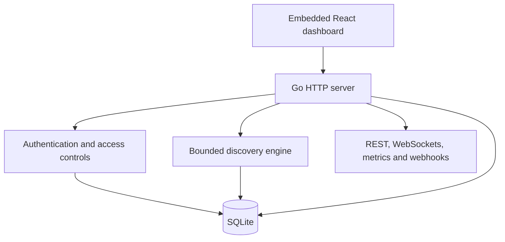

# NetSpectra

**Network visibility. Security through insight.**

[](https://github.com/TechieEngineer/netspectra/actions/workflows/ci.yml)
[](LICENSE)


NetSpectra is a local-first network inventory application written in Go with an embedded React and Tailwind CSS dashboard. It brings device observations, TCP service hints, historical inventory and authenticated monitoring interfaces into one portable executable, backed by SQLite.

**Status:** V1 release candidate. Intended for authorized local-network inventory and educational use. Not independently security-audited or production-certified.

[Source](https://github.com/TechieEngineer/netspectra) · [Releases](https://github.com/TechieEngineer/netspectra/releases) · [Project showcase (once deployed)](https://techieengineer.github.io/netspectra/) · [Security policy](SECURITY.md)

## Features

- Embedded web dashboard with live progress, searchable inventory, historical observations and logical topology visualization.
- Bounded concurrent discovery on authorized private IPv4 and loopback networks.
- SQLite persistence without a separate database server.
- Administrator setup, bcrypt password hashing, encrypted session cookies and revocable API keys.
- Authenticated REST API, WebSocket updates, Prometheus-compatible metrics and operator-configured HTTPS webhooks.
- Native builds, Docker deployment, automated testing and release workflows.

## Quick start

### Option A — Download a binary

When a release is published, open [GitHub Releases](https://github.com/TechieEngineer/netspectra/releases), select the appropriate operating system and architecture, and download its executable and matching checksum file. Review the release notes and verify the checksum before running it. Until release assets are available, use the source build below.

Windows PowerShell, from the download directory:

```powershell
Get-FileHash .\netspectra-windows-amd64.exe -Algorithm SHA256
# Compare the displayed hash with checksums-windows-amd64.txt.
.\netspectra-windows-amd64.exe
```

Open **http://127.0.0.1:8080** and create a unique administrator password (12–72 UTF-8 bytes). Keep the application bound to loopback. Stop the process with Ctrl+C.

### Option B — Build from source on Windows

Prerequisites: Git, an up-to-date supported Go toolchain (module minimum Go 1.25), Node.js 22 or newer, and npm. Use patched versions of these tools.

```powershell
git clone https://github.com/TechieEngineer/netspectra.git
cd netspectra
cd web
npm ci
npm run build
cd ..
go mod verify
go test ./...
go vet ./...
New-Item -ItemType Directory -Force bin | Out-Null
$env:CGO_ENABLED = "0"
go build -mod=readonly -trimpath -o bin/netspectra.exe ./cmd/netspectra
.\bin\netspectra.exe
```

Open http://127.0.0.1:8080. For a first functional test, use only your own computer's loopback address, `127.0.0.1/32`, with the authorization confirmation. Keep credentials and real inventory private.

### Option C — Build from source on Linux or macOS

```sh
git clone https://github.com/TechieEngineer/netspectra.git
cd netspectra
(cd web && npm ci && npm run build)
go mod verify
go test ./...
go vet ./...
mkdir -p bin
CGO_ENABLED=0 go build -mod=readonly -trimpath -o bin/netspectra ./cmd/netspectra
./bin/netspectra
```

Open http://127.0.0.1:8080. Cross-platform runtime verification is still outstanding; the Windows native build has been tested locally.

### Option D — Docker (native Linux recommended)

Prerequisites: Docker Engine and Docker Compose. From the cloned repository:

```sh
docker compose up --build -d
docker compose logs -f netspectra
```

Open http://127.0.0.1:8080 on the Linux host. Stop with `docker compose down`. The named database volume is retained. Docker Desktop networking differs from native Linux; prefer the native executable on Windows.

## Architecture



| Path | Responsibility |
| --- | --- |
| `cmd/netspectra/` | Startup, configuration and application entry point |
| `internal/scanner/` | Bounded discovery and inventory logic |
| `internal/auth/` | Authentication and session handling |
| `internal/store/` | SQLite storage and persistence |
| `internal/server/` | HTTP routes, access controls and integrations |
| `web/` | React dashboard and embedded frontend assets |
| `docs/` | Static public showcase, separate from the backend |
| `scripts/` | Local bootstrap and verification |
| `.github/workflows/` | CI, Pages and gated release builds |

Frontend assets must be built before compiling the Go executable. SQLite remains a separate writable data file. The committed lockfiles enable repeatable dependency installation.

## Engineering and cybersecurity case study

NetSpectra is a hands-on portfolio project exploring secure software development from architecture through testing and deployment, built with AI-assisted development and manual verification.

| Engineering area | Implementation and learning evidence |
| --- | --- |
| Go backend | Modular packages, bounded concurrency, cancellation and lifecycle management |
| Full-stack development | Embedded React dashboard, live state and logical inventory visualization |
| Data engineering | SQLite persistence, per-scan history, retention and single-process database ownership |
| Application security | Password hashing, encrypted cookies, hashed API keys, origin checks and access control |
| Security testing | Anonymous requests rejected; valid credentials accepted; revoked credentials rejected |
| Dependency remediation | PostCSS and Gorilla WebSocket advisories investigated, dependencies updated and tests repeated |
| DevSecOps | Lockfiles, vulnerability checks, CI, non-root Docker builds and gated releases |
| Systems troubleshooting | Docker/WSL storage failure diagnosed and writable storage restored |

The project emphasizes evidence-based verification rather than treating a successful build as proof of security.

## Integration for developers

Run your own NetSpectra instance locally. A trusted application backend can consume authenticated inventory and aggregate metrics; never expose a NetSpectra API key in browser JavaScript, URLs or public repositories. Current keys are not read-only and have no fine-grained scope. Use a temporary key for local integration testing and revoke it afterward.

| Method | Endpoint | Purpose |
| --- | --- | --- |
| GET | `/api/v1/hosts` | Existing inventory |
| GET | `/api/v1/scans` | Historical observations |
| GET | `/metrics` | Aggregate monitoring metrics |

See [INTEGRATION.md](INTEGRATION.md) for the full interface contract, authentication requirements, and webhook configuration. The public GitHub Pages showcase contains illustrative data and does not run the Go backend.

## Verification

Windows PowerShell, from the repository root (review the script before executing):

```powershell
powershell -NoProfile -ExecutionPolicy RemoteSigned -File scripts/verify.ps1
```

Manual checks recorded during development include native Windows execution, dashboard operation, successful authentication, rejection of unauthenticated requests, API key revocation and Docker build/version/non-root checks. At the reported local verification checkpoint, npm and reachable-code Go vulnerability checks reported no findings; additional module-level findings remained for review.

See [VERIFICATION.md](VERIFICATION.md), [CI results](https://github.com/TechieEngineer/netspectra/actions/workflows/ci.yml) and [RELEASE-CHECKLIST.md](RELEASE-CHECKLIST.md) for evidence and acceptance criteria. Audit results can change as new advisories are published.

## Security boundaries and known limitations

- Use only on networks you own or are explicitly authorized to assess. Private IP addresses alone do not establish authorization.
- Keep this release candidate local; do not expose it directly to the public Internet.
- Inventory can miss silent devices. Service labels are hints, not verified fingerprints; topology is logical, not a physical network map.
- MAC/vendor visibility is limited by platform, neighbor information and the optional OUI dataset.
- Database encryption at rest, fine-grained API key scopes, stronger resource quotas and comprehensive backup/recovery testing remain future work.
- Independent security review, remaining dependency findings and external integration tests remain outstanding. No throughput benchmark or production security certification is claimed.
- Treat local databases, API keys, webhook URLs and backups as sensitive. See [SECURITY.md](SECURITY.md) for reporting and operational guidance.

## License and contributions

MIT — see [LICENSE](LICENSE). Contributions, documentation improvements and responsible security reports are welcome. Discuss significant changes before submitting a pull request and include relevant tests. Report sensitive security findings according to the security policy rather than in a public issue.
